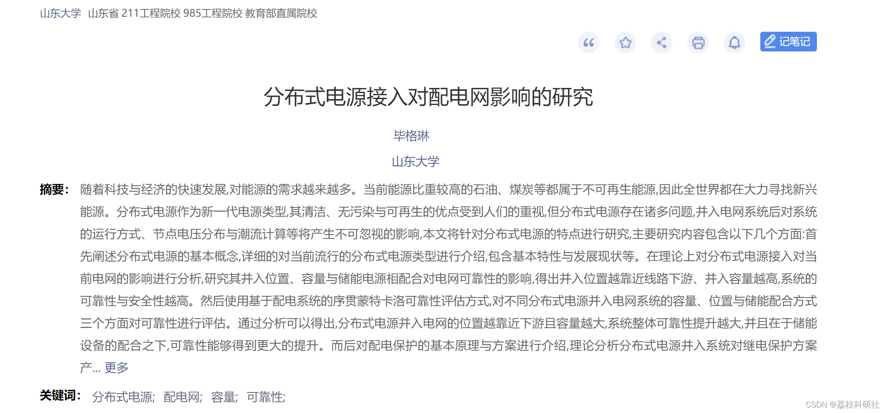
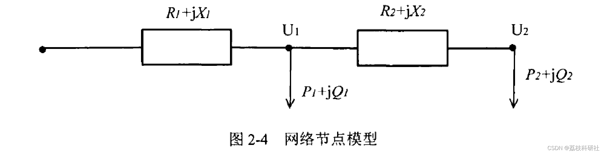
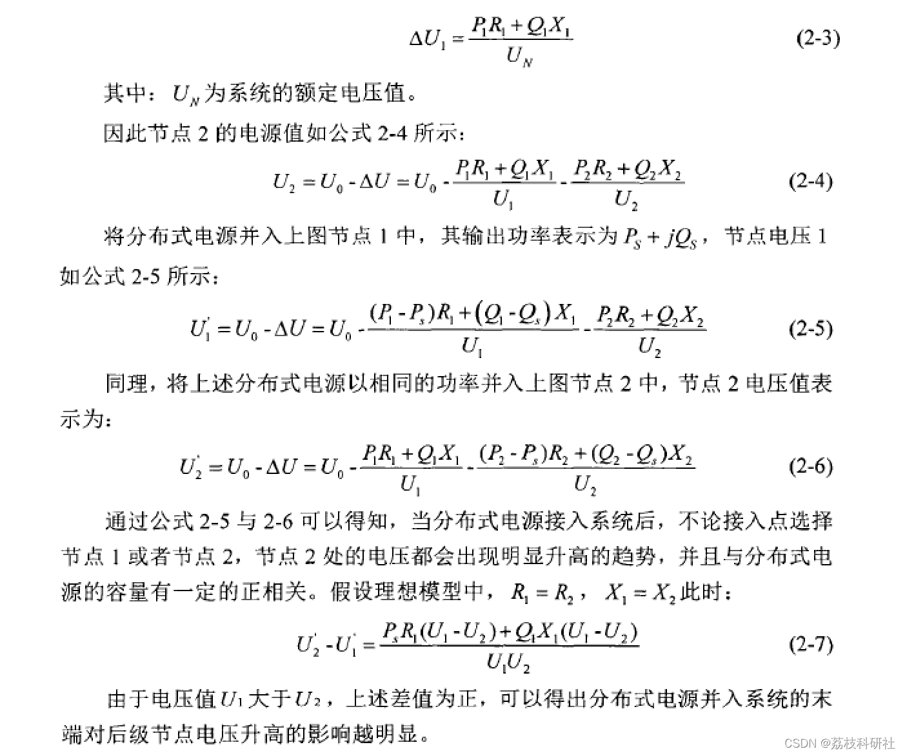
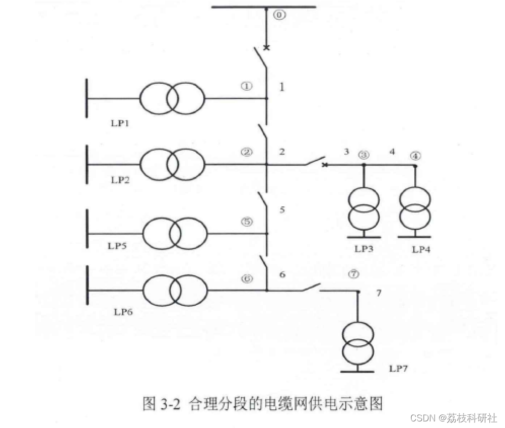
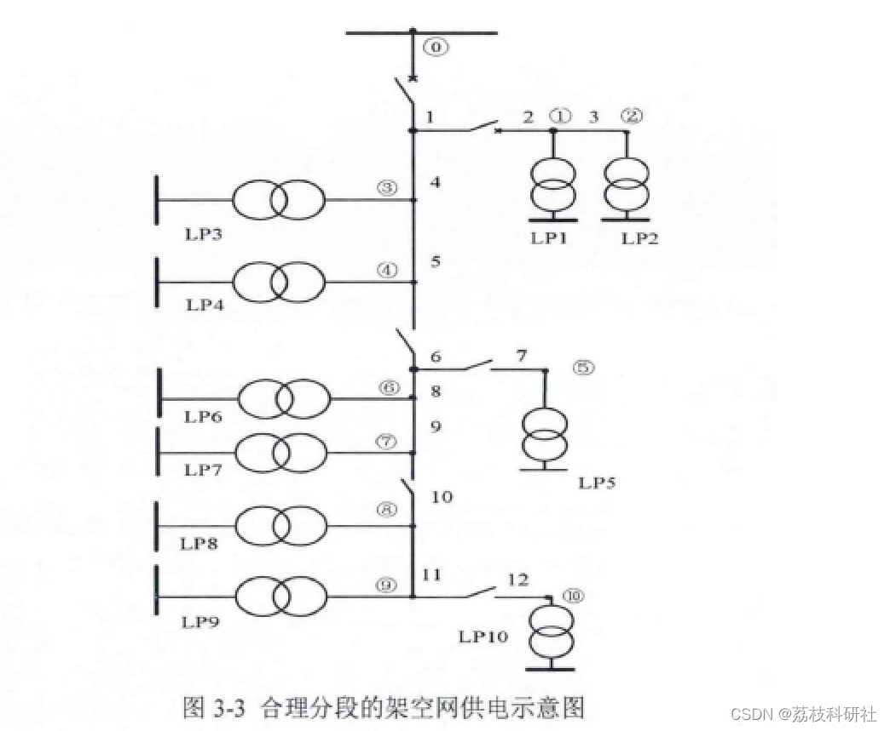
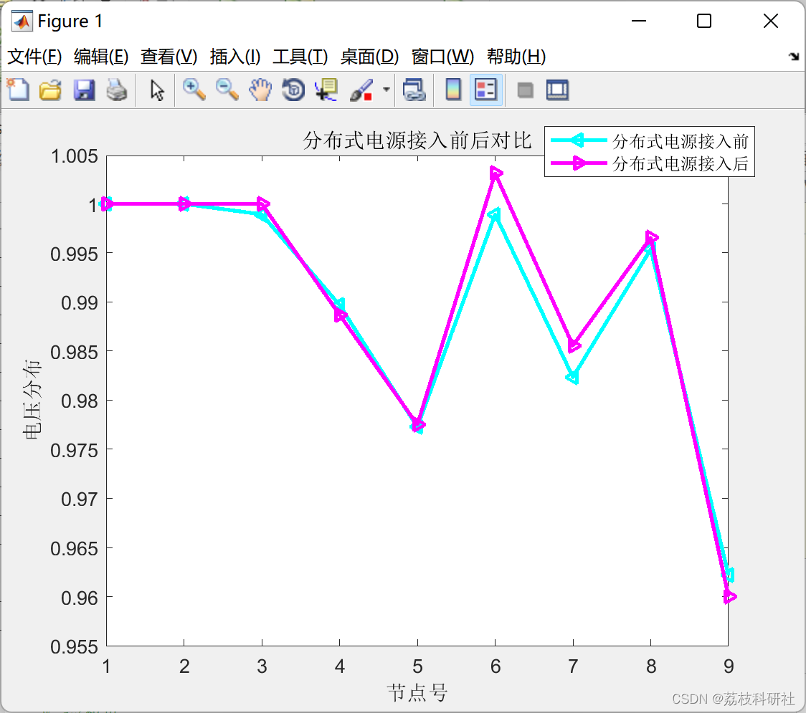
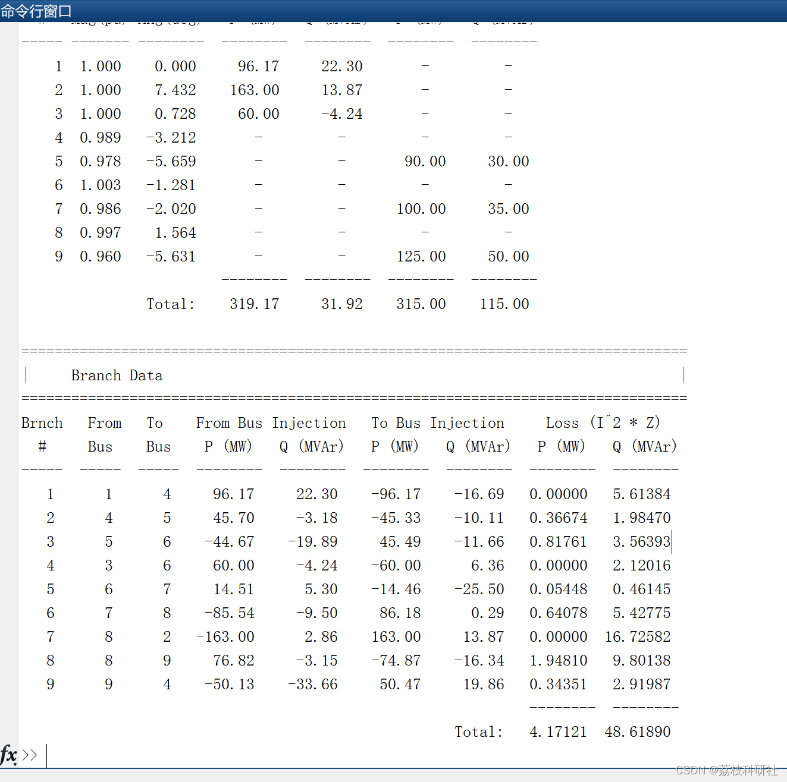

# Research on the Impact of Distributed Power Sources on Distribution Network (Matlab Code Implementation)

🏆 Bloggers' Advantage: 🌞🌞🌞 The content of the blog strives to be rigorous in thought and clear in logic, for the convenience of readers.
⛳️ Mantra: The journey of a hundred miles is half done in the last ninety.
📋📋📋This article is organized as follows: 🎁🎁🎁Table of Contents💥1 Overview 1.1 Inclusion Capacity 1.2 Inclusion Location📚2 Run Results 🌈3 MATLAB Code Implementation🎉4 References
💥1 Overview of the reference paper:
​  
With the rapid development of technology and economy, there is an increasing demand for energy. Currently, oil and coal, which have a high proportion of energy, are non-renewable resources. Therefore, the world is vigorously seeking new energy sources. Distributed power generation, as a new type of power source, has received attention due to its clean, pollution-free, and renewable advantages. However, distributed power generation faces numerous issues, and its integration into the power grid system will have significant impacts on the operation mode of the system, node voltage distribution, and power flow calculations. This paper will study the characteristics of distributed power generation, focusing mainly on the following aspects: Firstly, it will elaborate on the basic concept of distributed power generation, introduce in detail the current popular types of distributed power generation, including their basic characteristics and development status. Theoretically, it will analyze the impact of distributed power generation on the current power grid by analyzing its impact on the reliability of the grid when integrated at different positions, capacities, and storage power sources. It will conclude that integrating closer to the downstream of the line and higher capacity can enhance the system's reliability and safety. Then, using a sequential Monte Carlo reliability assessment method based on the distribution system, it will evaluate the reliability of different distributed power generation systems by considering the capacity, position, and storage cooperation methods. Through analysis, it can be concluded that the closer the location of distributed power generation to the downstream and the larger the capacity, the greater the overall system reliability improvement. Moreover, with the cooperation of storage devices, the reliability can be further enhanced. Subsequently, it will introduce the basic principles and schemes of distribution protection, theoretically analyze the impact of distributed power generation on relay protection schemes, focus on the analysis of current protection in the grid, build a mathematical model based on this, use specific examples to analyze the specific impact of faults occurring on the upstream or downstream of distributed power generation, and establish a multi-distributed power generation grid connection model. It will also analyze the impact of distributed power generation on the automatic protection of feeder lines within the system, ultimately constructing a model for the capacity of distributed power generation integration into the system. Finally, it will analyze the impact of photovoltaic power generation systems integrating into the grid on system voltage, network losses, and protection equipment, and establish models for numerical analysis. A similar capacity photovoltaic power generation system connected to different network nodes will have different impacts on system node voltage and flow distribution. Similarly, different capacity photovoltaic power generation systems connected to the same network node will also have different impacts on system node voltage and flow distribution. These two methods will also affect the normal operation of system protection equipment.
In traditional power grid structures, the topology of the grid often exhibits a radial pattern, where voltages continuously decrease in response to the direction of feeder flow during normal operation. When distributed generation is integrated into the system, the output power from the feeders will decrease. The reactive power output by distributed generation supports the reactive power needs of subsequent grid systems, resulting in increased voltage at various nodes downstream. To better analyze the impact of distributed generation on system node voltages, a model is established as shown in the figure.
​  
In order to facilitate the analysis of the model, only the longitudinal component of the system's voltage loss is considered.
​  
1.1 Integration Capacity
To facilitate the observation and analysis of the impacts of distributed power sources being integrated into the grid, the installed capacity range for distributed power sources is set to be [0, 1] times the maximum single-line load. Typical values such as 0.1 times, 0.2 times, up to 1 times are selected. Similarly, the reliability calculation results take a value range of [0, 0.47] times the maximum single-line load.
1.2 Integration location
The reliability of microgrids formed by the integration of distributed power sources into feeders is significantly related to the structure of the power grid lines. Therefore, it is necessary to reasonably segment the power grid model and the feeder part within the overhead network model, as shown in Figures 3-2 and 3-3.
Editor
Editor
Based on the numerous performance characteristics of the main and branch networks, as well as the end-to-end lines, and according to the cable network power supply model shown in Figure 3-2, bus BUS4 and bus BUS6 are selected as the grid-connected locations for distributed power sources; according to the overhead network power supply mode shown in Figure 3-3, bus BUS2, bus BUS6, and bus BUS9 are selected as the grid-connected locations for distributed power sources.
📚2 Running Results Editing
Editor
Please enter the node location of the distributed power source, as well as the magnitude of active and reactive power - bus PG QG.
DGs2 =  
0  0  1  0  1  0  0  0  0  0  0  0  0  0  0  0  0  0  
Please enter the value of DG node position: 3
Please enter the value of DG active power: 60
Please enter the value of DG reactive power: 50
DGs1 =  
3  60  50  
DGs =  
1 to 20 columns
3  60  50  0  0  1  0  1  0  0  0  0  0  0  0  0  0  0  0  0  
21 Columns
0  
mpc =  
A struct containing the following fields:
version: '2'  
baseMVA: 100  
bus: [9×13 double]  
gen: [3×21 double]  
branch: [9×17 double]  
et: 0.0400  
success: 1  
Newton's method power flow converged in 4 iterations.  
Converged in 19.01 seconds  
================================================================================  
|  System Summary                             |  
================================================================================  
How many?        How much?       P (MW)      Q (MVAr)  
---------------------  ------------------- ------------- -----------------  
Buses       9  Total Gen Capacity   0.0     0.0 to 0.0  
Generators    3  On-line Capacity    0.0     0.0 to 0.0  
Committed Gens  3  Generation (actual)  319.2       31.9  
Loads       3  Load         315.0      115.0  
Fixed      3   Fixed        315.0      115.0  
Dispatchable  0   Dispatchable     -0.0 of -0.0   -0.0  
Shunts      0  Shunt (inj)      -0.0       0.0  
Branches     9  Losses (I^2 * Z)    4.17      48.62  
Transformers   0  Branch Charging (inj)  -       131.7  
Inter-ties    0  Total Inter-tie Flow  0.0       0.0  
Areas       1  
Minimum           Maximum  
------------------------- --------------------------------  
Voltage Magnitude 0.960 p.u. @ bus 9     1.003 p.u. @ bus 6  
Voltage Angle   -5.66 deg @ bus 5     7.43 deg @ bus 2  
P Losses (I^2*R)      -         1.95 MW  @ line 8-9  
Q Losses (I^2*X)      -        16.73 MVAr @ line 8-2  
================================================================================  
|  Bus Data                                |  
================================================================================  
Bus   Voltage     Generation      Load  
# Mag(pu) Ang(deg) P (MW) Q (MVAr) P (MW) Q (MVAr)  
----- ------- -------- -------- -------- -------- --------  
1 1.000  0.000  96.17  22.30   -    -  
2 1.000  7.432  163.00  13.87   -    -  
3 1.000  0.728  60.00  -4.24   -    -  
4 0.989 -3.212   -    -    -    -  
5 0.978 -5.659   -    -   90.00  30.00  
6 1.003 -1.281   -    -    -    -  
7 0.986 -2.020   -    -   100.00  35.00  
8 0.997  1.564   -    -    -    -  
9 0.960 -5.631   -    -   125.00  50.00  
-------- -------- -------- --------  
Total:  319.17  31.92  315.00  115.00  
================================================================================  
|  Branch Data                               |  
================================================================================  
Brnch From To  From Bus Injection To Bus Injection  Loss (I^2 * Z)  
#  Bus  Bus  P (MW) Q (MVAr) P (MW) Q (MVAr) P (MW) Q (MVAr)  
----- ----- ----- -------- -------- -------- -------- -------- --------  
1   1   4  96.17  22.30  -96.17  -16.69 0.00000 5.61384  
2   4   5  45.70  -3.18  -45.33  -10.11 0.36674 1.98470  
3   5   6  -44.67  -19.89  45.49  -11.66 0.81761 3.56393  
4   3   6  60.00  -4.24  -60.00   6.36 0.00000 2.12016  
5   6   7  14.51   5.30  -14.46  -25.50 0.05448 0.46145  
6   7   8  -85.54  -9.50  86.18   0.29 0.64078 5.42775  
7   8   2 -163.00   2.86  163.00  13.87 0.00000 16.72582  
8   8   9  76.82  -3.15  -74.87  -16.34 1.94810 9.80138  
9   9   4  -50.13  -33.66  50.47  19.86 0.34351 2.91987  
-------- --------  
Total: 4.17121 48.61890  
>>  
🌈3 Matlab code implementation:
%% Node Type
function [ref, pv, pq] = bustypes(bus, gen)  
% Create reference nodes, pq nodes, and pv nodes.
[PQ, PV, REF, NONE, BUS_I, BUS_TYPE, PD, QD, GS, BS, BUS_AREA, VM, ...  
VA, BASE_KV, ZONE, VMAX, VMIN, LAM_P, LAM_Q, MU_VMAX, MU_VMIN] = idx_bus;  
[GEN_BUS, PG, QG, QMAX, QMIN, VG, MBASE, GEN_STATUS, PMAX, PMIN, ...  
MU_PMAX, MU_PMIN, MU_QMAX, MU_QMIN, PC1, PC2, QC1MIN, QC1MAX, ...  
QC2MIN, QC2MAX, RAMP_AGC, RAMP_10, RAMP_30, RAMP_Q, APF] = idx_gen;  
nb = size(bus, 1);  
ng = size(gen, 1);  
Cg = sparse(gen(:, GEN_BUS), (1:ng)', gen(:, GEN_STATUS) > 0, nb, ng);  
bus_gen_status = Cg * ones(ng, 1);  
ref = find(bus(:, BUS_TYPE) == REF & bus_gen_status); %% Reference node index
pv = find(bus(:, BUS_TYPE) == PV & bus_gen_status); %% PV node index
pq = find(bus(:, BUS_TYPE) == PQ | ~bus_gen_status); %% PQ node index
%% Node Type
function [ref, pv, pq] = bustypes(bus, gen)  
% Create reference nodes, pq nodes, and pv nodes.
[PQ, PV, REF, NONE, BUS_I, BUS_TYPE, PD, QD, GS, BS, BUS_AREA, VM, ...  
VA, BASE_KV, ZONE, VMAX, VMIN, LAM_P, LAM_Q, MU_VMAX, MU_VMIN] = idx_bus;  
[GEN_BUS, PG, QG, QMAX, QMIN, VG, MBASE, GEN_STATUS, PMAX, PMIN, ...  
MU_PMAX, MU_PMIN, MU_QMAX, MU_QMIN, PC1, PC2, QC1MIN, QC1MAX, ...  
QC2MIN, QC2MAX, RAMP_AGC, RAMP_10, RAMP_30, RAMP_Q, APF] = idx_gen;  
nb = size(bus, 1);  
ng = size(gen, 1);  
Cg = sparse(gen(:, GEN_BUS), (1:ng)', gen(:, GEN_STATUS) > 0, nb, ng);  
bus_gen_status = Cg * ones(ng, 1);  
ref = find(bus(:, BUS_TYPE) == REF & bus_gen_status); %% Reference node index
pv = find(bus(:, BUS_TYPE) == PV & bus_gen_status); %% PV node index
pq = find(bus(:, BUS_TYPE) == PQ | ~bus_gen_status); %% PQ node index
🎉4 References

## Images

<!-- PAYMENT_BLOCK -->

## Get this dataset

- Payment link (Stripe): [Buy now](https://buy.stripe.com/3cs8yP7sY87d0vu9AB)
- Payment QR code: 

<!-- /PAYMENT_BLOCK -->
